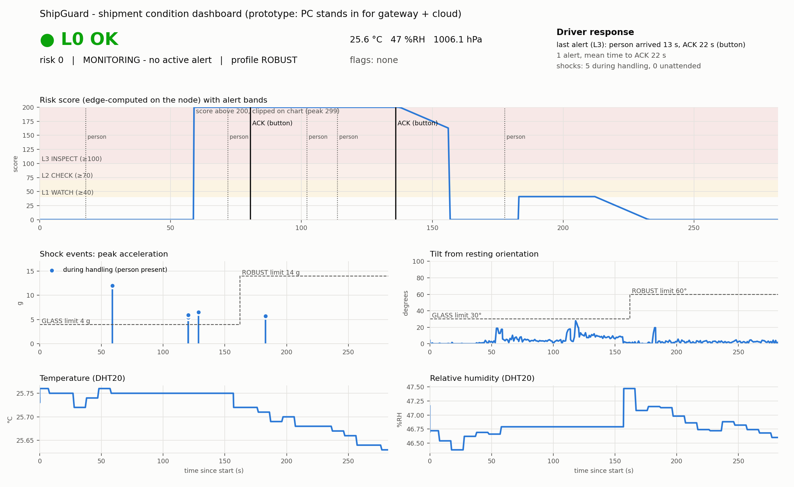
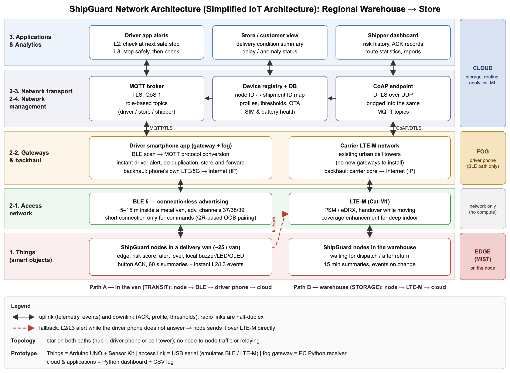

# ShipGuard: Fragility-Aware Shipment Guardian

A battery-powered node that rides inside a fragile package, computes a **product-specific damage-risk score on the edge** from shock, tilt and (planned) vibration, and escalates through four alert levels with local alarms and a driver acknowledgement (ACK) loop.

Built on an Arduino UNO R3 + Arduino Sensor Kit as a course prototype (CMU 14-767 IoT Wireless Protocols and Standards, Fall 2026). The firmware core is portable C/C++ and unit-tested on the host.

> **Demo video:** [Google Drive link](TODO-ADD-LINK)
> **Final report:** [docs/report/ShipGuard_Final_Report.pdf](docs/report/ShipGuard_Final_Report.pdf) · **Poster:** [poster/ShipGuard_Poster_v3.pdf](poster/ShipGuard_Poster_v3.pdf)



## What it does

- Samples a 3-axis accelerometer at 400 Hz (±16 g) and extracts impact peak, velocity change and a gated tilt angle in fixed-point.
- Scores risk 0–100 against one of three sensitivity profiles (glass/ceramic, electronics, rugged), selected with a potentiometer.
- Maps the score to levels L0–L3 with hysteresis. Buzzer pattern, LED and OLED text follow the level. A saturated sensor reading is treated as "at least this large" and escalates conservatively.
- The driver acknowledges with the board button or a PC command; the ACK time is logged. A PIR sensor emulates "driver arrived" to measure response time.
- Sends CRC-8 framed telemetry over serial. A Python gateway parses it, logs CSV and sends commands (ACK, profile, report interval, new shipment). A dashboard plots the run.

## Architecture



The prototype keeps a wired USB serial link. In the deployed design (a metropolitan last-mile route, regional warehouse to stores), BLE 5 replaces that link inside the van (node to driver's phone) and LTE-M is used in the warehouse or when no phone responds. In the prototype, `pc/gateway.py` stands in for the phone gateway (fog) and `pc/dashboard.py` for the cloud and application layers. The communication plan is a paper design; only the serial link is implemented.

## Repository layout

| Path | Contents |
|---|---|
| `firmware/shipguard/` | Portable core (`crc8`, `frame`, `features`, `risk`, `fsm`) plus the Arduino sketch `shipguard.ino` |
| `firmware/tests/` | Host unit tests for the core |
| `firmware/smoke_test/` | Hardware bring-up sketch (I2C scan, sample rate, range, tilt, I/O) |
| `pc/` | `gateway.py` (receiver and command console), `dashboard.py`, `analyze_experiment.py` |
| `docs/design.md` | Design document: scoring formula, state machine, frame format, memory budget |
| `docs/report/`, `poster/` | Final report and poster |

## Build and run

Host tests (no hardware):

```bash
make test
```

Firmware: open `firmware/shipguard/shipguard.ino` in the Arduino IDE (board: Arduino UNO). Requires the `Arduino_SensorKit` library and the Grove `LIS3DHTR` driver. All sources sit flat in the sketch folder because the Arduino build ignores `.cpp` files in subfolders.

PC side:

```bash
python3 pc/gateway.py      # terminal 1: receiver, logs to pc/data/
python3 pc/dashboard.py    # terminal 2: live dashboard
```

## Measured results

| Item | Value |
|---|---|
| Flash | 21,986 B (68%) |
| SRAM (static) | 1,092 B (53%); 887–914 B free at runtime |
| Accelerometer read rate | 393 samples/s at 400 Hz ODR, no sample loss |
| Frame integrity | 0 CRC errors, 0 sequence gaps in the integration run |
| Host unit tests | 10 tests passing |

## Status and limits

- **Done:** MVP on hardware (two-state monitor/alert, shock and tilt scoring, local alerts, ACK, serial protocol, gateway, dashboard).
- **Not done yet:** box-drop calibration of the thresholds, vibration RMS and cumulative damage, STORAGE/TRANSIT/HANDLING context states, ACK-timeout escalation, pre-trigger buffer, loss-injection tests, a datasheet-based power model, and a BLE port.
- Thresholds are **example values, not certified**. This project quantifies risk and shortens the time to human intervention. It does not claim to prevent damage.
- The UNO cannot give measured power numbers, and the sensor kit does not expose the accelerometer interrupt pin, so the prototype keeps sampling at 400 Hz and reduces only processing and reporting rate by state.
- Similar commercial products exist (for example Lansmont SAVER AM and Tive). This is a learning prototype, not a claim of superiority.
